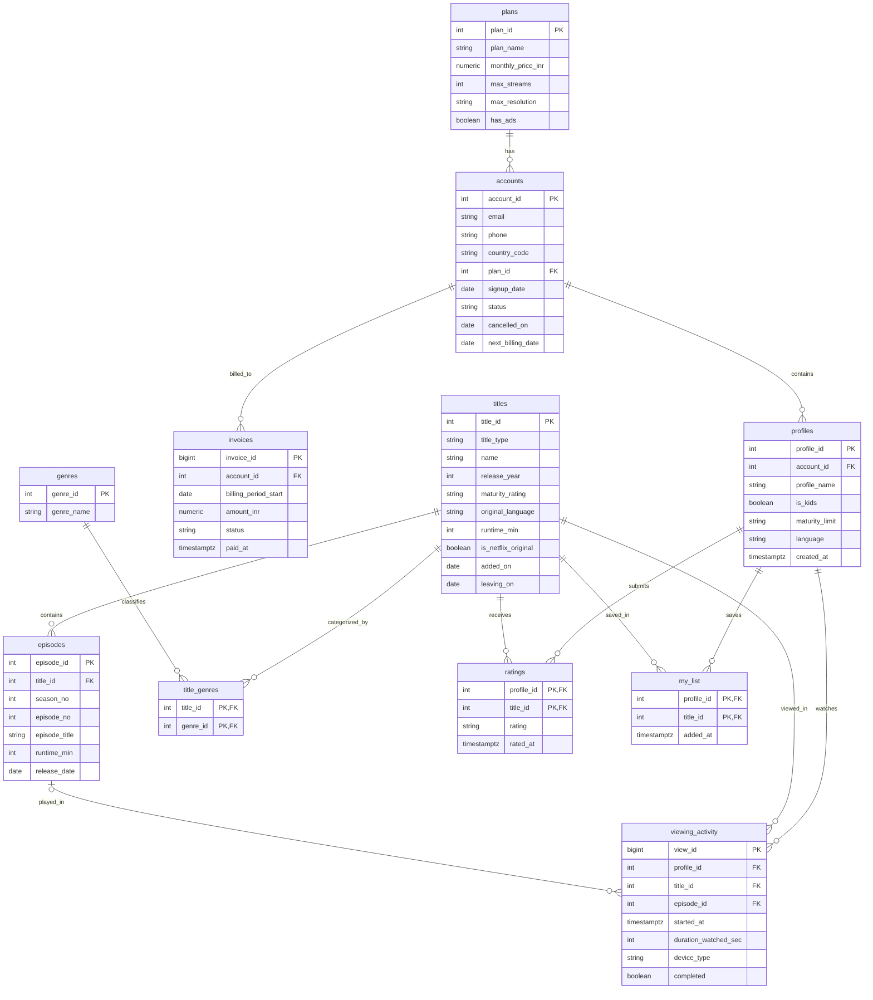

# Database Schema Design

## 1. Database Overview

The project uses PostgreSQL to design a relational database for a Netflix-like streaming platform.

The database manages the following major areas:

- Subscription plans and accounts
- User profiles
- Movies and TV series
- Genres and episodes
- Viewing activity
- User ratings and personal watchlists
- Subscription invoices

The database is designed to maintain data consistency through primary keys, foreign keys, unique constraints, NOT NULL constraints, and CHECK constraints.

The schema is intended to support both customer-facing queries and analytical workloads.

## 2. Data Dictionary

The database consists of 11 core tables designed from the production CSV export. Below is the full data dictionary specifying table, column, data type, constraints, and business justifications.

### 2.1 plans
Stores subscription tiers offered to subscribers.

| Column | Data Type | Constraints | Why & Business Rule |
|---|---|---|---|
| `plan_id` | `INTEGER` | `PRIMARY KEY` | Unique numeric identifier for subscription plan. |
| `plan_name` | `VARCHAR(50)` | `NOT NULL, UNIQUE, CHECK (plan_name IN ('MOBILE','BASIC','STANDARD','PREMIUM'))` | Tier name. Constrained to the 4 supported product tiers. |
| `monthly_price_inr` | `NUMERIC(8,2)` | `NOT NULL, CHECK (monthly_price_inr >= 0)` | Recurring price in INR. Exact monetary representation. |
| `max_streams` | `INTEGER` | `NOT NULL, CHECK (max_streams > 0)` | Number of simultaneous devices allowed. |
| `max_resolution` | `VARCHAR(10)` | `NOT NULL, CHECK (max_resolution IN ('480p','720p','1080p','4K'))` | Maximum playback quality supported by the tier. |
| `has_ads` | `BOOLEAN` | `NOT NULL DEFAULT FALSE` | Flag indicating ad-supported plans (currently all False in seed data). |

### 2.2 accounts
Stores customer subscriber accounts (one account per subscribing household).

| Column | Data Type | Constraints | Why & Business Rule |
|---|---|---|---|
| `account_id` | `INTEGER` | `PRIMARY KEY` | Unique customer account number. |
| `email` | `VARCHAR(255)` | `NOT NULL, UNIQUE` | Login identifier. Must be unique across all accounts. |
| `phone` | `VARCHAR(20)` | `NULL` | Optional customer contact phone number (4,888 accounts have no phone). |
| `country_code` | `VARCHAR(10)` | `NOT NULL` | Country of account registration (e.g., IN, AE, SG). |
| `plan_id` | `INTEGER` | `NOT NULL, FK -> plans(plan_id) ON DELETE RESTRICT` | Active subscription tier. `RESTRICT` prevents accidental deletion of active plans. |
| `signup_date` | `DATE` | `NOT NULL` | Date customer originally subscribed. |
| `status` | `VARCHAR(20)` | `NOT NULL, CHECK (status IN ('ACTIVE','CANCELLED','ON_HOLD'))` | Subscription lifecycle status. |
| `cancelled_on` | `DATE` | `NULL, CHECK (status <> 'CANCELLED' OR cancelled_on IS NOT NULL)` | Cancellation timestamp. Required if account is CANCELLED. |
| `next_billing_date`| `DATE` | `NULL` | Next scheduled renewal date. Nullable for cancelled accounts. |

*Table-level Constraints:*
- `CHECK (cancelled_on IS NULL OR cancelled_on >= signup_date)`
- `CHECK (next_billing_date IS NULL OR next_billing_date >= signup_date)`

### 2.3 profiles
Individual viewing profiles within an account (up to 5 per account).

| Column | Data Type | Constraints | Why & Business Rule |
|---|---|---|---|
| `profile_id` | `INTEGER` | `PRIMARY KEY` | Unique profile identifier. |
| `account_id` | `INTEGER` | `NOT NULL, FK -> accounts(account_id) ON DELETE CASCADE` | Parent household account. If account is purged, profiles cascade. |
| `profile_name` | `VARCHAR(100)` | `NOT NULL` | Display name of the profile. |
| `is_kids` | `BOOLEAN` | `NOT NULL DEFAULT FALSE` | Flag designating a kids-restricted viewing experience. |
| `maturity_limit` | `VARCHAR(10)` | `NOT NULL, CHECK (maturity_limit IN ('U','UA7','UA13','UA16','A'))` | Maturity ceiling for the profile. |
| `language` | `VARCHAR(50)` | `NOT NULL DEFAULT 'English'` | UI language preference. |
| `created_at` | `TIMESTAMPTZ` | `NOT NULL` | Timestamp with timezone when profile was created. |

*Table-level Constraint:*
- `CHECK (NOT is_kids OR maturity_limit IN ('U', 'UA7'))`: Enforces that kids profiles can never have maturity limits above U or UA7.

### 2.4 genres
Master list of catalog genres.

| Column | Data Type | Constraints | Why & Business Rule |
|---|---|---|---|
| `genre_id` | `INTEGER` | `PRIMARY KEY` | Unique genre ID. |
| `genre_name` | `VARCHAR(50)` | `NOT NULL, UNIQUE, CHECK (length(trim(genre_name)) > 0)` | Genre label (e.g. Comedy, Drama). Must be unique and non-empty. |

### 2.5 titles
Catalog titles including both movies and episodic series.

| Column | Data Type | Constraints | Why & Business Rule |
|---|---|---|---|
| `title_id` | `INTEGER` | `PRIMARY KEY` | Unique catalog identifier. |
| `title_type` | `VARCHAR(10)` | `NOT NULL, CHECK (title_type IN ('MOVIE', 'SERIES'))` | Content format discriminator. |
| `name` | `VARCHAR(255)` | `NOT NULL` | Content display title. |
| `release_year` | `INTEGER` | `NOT NULL, CHECK (release_year BETWEEN 1900 AND 2100)` | Original year of release. |
| `maturity_rating`| `VARCHAR(10)` | `NOT NULL, CHECK (maturity_rating IN ('U','UA7','UA13','UA16','A'))` | Official CBFC/content rating. |
| `original_language`| `VARCHAR(50)`| `NOT NULL` | Original audio language. |
| `runtime_min` | `INTEGER` | `NULL` | Movie length in minutes. NULL for series (tracked at episode level). |
| `is_netflix_original`| `BOOLEAN`| `NOT NULL DEFAULT FALSE` | Flag for first-party Originals. |
| `added_on` | `DATE` | `NOT NULL` | Date title was added to the Netflix catalog. |
| `leaving_on` | `DATE` | `NULL` | Date title leaves service. NULL for perpetual titles. |

*Table-level Constraints:*
- `CHECK ((title_type = 'MOVIE' AND runtime_min IS NOT NULL AND runtime_min > 0) OR (title_type = 'SERIES' AND runtime_min IS NULL))`: Ensures movies always have runtime while series do not store single runtimes.
- `CHECK (NOT is_netflix_original OR leaving_on IS NULL)`: Originals never leave the platform.
- `CHECK (leaving_on IS NULL OR leaving_on >= added_on)`: Removal date cannot precede addition date.

### 2.6 title_genres
Bridge table supporting the many-to-many relationship between titles and genres.

| Column | Data Type | Constraints | Why & Business Rule |
|---|---|---|---|
| `title_id` | `INTEGER` | `NOT NULL, FK -> titles(title_id) ON DELETE CASCADE` | Reference to parent title. |
| `genre_id` | `INTEGER` | `NOT NULL, FK -> genres(genre_id) ON DELETE RESTRICT` | Reference to genre. `RESTRICT` prevents deleting in-use genres. |

*Primary Key:* Composite `(title_id, genre_id)`.

### 2.7 episodes
Individual episodes belonging to TV series.

| Column | Data Type | Constraints | Why & Business Rule |
|---|---|---|---|
| `episode_id` | `INTEGER` | `PRIMARY KEY` | Unique episode identifier. |
| `title_id` | `INTEGER` | `NOT NULL, FK -> titles(title_id) ON DELETE CASCADE` | Reference to parent TV series. Cascades on series removal. |
| `season_no` | `INTEGER` | `NOT NULL, CHECK (season_no > 0)` | Season index (1-based). |
| `episode_no` | `INTEGER` | `NOT NULL, CHECK (episode_no > 0)` | Episode index within the season (1-based). |
| `episode_title`| `VARCHAR(255)`| `NOT NULL` | Title of the specific episode. |
| `runtime_min` | `INTEGER` | `NOT NULL, CHECK (runtime_min > 0)` | Episode runtime in minutes. |
| `release_date`| `DATE` | `NOT NULL` | Release date of the episode. |

*Candidate Key:* `UNIQUE (title_id, season_no, episode_no)`.

### 2.8 viewing_activity
Streaming playback history records (200,401 seed events).

| Column | Data Type | Constraints | Why & Business Rule |
|---|---|---|---|
| `view_id` | `BIGINT` | `PRIMARY KEY` | High-volume primary key supporting billions of viewing events. |
| `profile_id` | `INTEGER` | `NOT NULL, FK -> profiles(profile_id) ON DELETE CASCADE` | Profile that initiated the stream. |
| `title_id` | `INTEGER` | `NOT NULL, FK -> titles(title_id) ON DELETE CASCADE` | Content streamed. |
| `episode_id` | `INTEGER` | `NULL, FK -> episodes(episode_id) ON DELETE CASCADE` | Episode streamed. NULL for standalone movies. |
| `started_at` | `TIMESTAMPTZ` | `NOT NULL` | Exact playback start timestamp with timezone. |
| `duration_watched_sec`| `INTEGER`| `NOT NULL, CHECK (duration_watched_sec >= 0)` | Duration consumed in seconds. Non-negative. |
| `device_type` | `VARCHAR(20)` | `NOT NULL, CHECK (device_type IN ('TV','MOBILE','TABLET','LAPTOP'))` | Playback client hardware category. |
| `completed` | `BOOLEAN` | `NOT NULL DEFAULT FALSE` | Playback completion flag (e.g. credit roll reached). |

### 2.9 ratings
User explicit feedback on titles.

| Column | Data Type | Constraints | Why & Business Rule |
|---|---|---|---|
| `profile_id` | `INTEGER` | `NOT NULL, FK -> profiles(profile_id) ON DELETE CASCADE` | Profile giving the rating. |
| `title_id` | `INTEGER` | `NOT NULL, FK -> titles(title_id) ON DELETE CASCADE` | Content being rated. |
| `rating` | `VARCHAR(20)` | `NOT NULL, CHECK (rating IN ('LOVE','THUMBS_UP','THUMBS_DOWN'))` | Explicit feedback score. |
| `rated_at` | `TIMESTAMPTZ` | `NOT NULL` | Submission timestamp with timezone. |

*Primary Key:* Composite `(profile_id, title_id)` (one rating per title per profile).

### 2.10 my_list
Personal saved watchlist entries.

| Column | Data Type | Constraints | Why & Business Rule |
|---|---|---|---|
| `profile_id` | `INTEGER` | `NOT NULL, FK -> profiles(profile_id) ON DELETE CASCADE` | Profile watchlist owner. |
| `title_id` | `INTEGER` | `NOT NULL, FK -> titles(title_id) ON DELETE CASCADE` | Bookmarked title. |
| `added_at` | `TIMESTAMPTZ` | `NOT NULL` | Timestamp title was bookmarked. |

*Primary Key:* Composite `(profile_id, title_id)`.

### 2.11 invoices
Billing history and collection state for subscription periods.

| Column | Data Type | Constraints | Why & Business Rule |
|---|---|---|---|
| `invoice_id` | `BIGINT` | `PRIMARY KEY` | High-volume unique invoice identifier. |
| `account_id` | `INTEGER` | `NOT NULL, FK -> accounts(account_id) ON DELETE CASCADE` | Billed customer account. |
| `billing_period_start`| `DATE` | `NOT NULL, CHECK (EXTRACT(DAY FROM billing_period_start) = 1)` | Monthly billing cycle start date (always 1st of month). |
| `amount_inr` | `NUMERIC(8,2)`| `NOT NULL, CHECK (amount_inr >= 0)` | Billed amount in INR. Preserves immutable billing history. |
| `status` | `VARCHAR(20)` | `NOT NULL, CHECK (status IN ('PAID','FAILED','REFUNDED'))` | Settlement status. |
| `paid_at` | `TIMESTAMPTZ` | `NULL` | Settlement timestamp. NULL for failed or pending charges. |

*Table-level Constraint:*
- `CHECK (status <> 'FAILED' OR paid_at IS NULL)`: Invoices that failed settlement cannot have a payment timestamp.

## 3. Primary Key and Foreign Key Relationships

Primary keys uniquely identify records in each table. Foreign keys establish relationships between related tables and help maintain referential integrity.

### 3.1 Primary Keys

The proposed primary keys are:

| Table | Primary Key |
|---|---|
| plans | plan_id |
| accounts | account_id |
| profiles | profile_id |
| genres | genre_id |
| titles | title_id |
| title_genres | (title_id, genre_id) |
| episodes | episode_id |
| viewing_activity | view_id |
| ratings | (profile_id, title_id) |
| my_list | (profile_id, title_id) |
| invoices | invoice_id |

### 3.2 Foreign Keys

| Child Table | Foreign Key | Referenced Table |
|---|---|---|
| accounts | plan_id | plans(plan_id) |
| profiles | account_id | accounts(account_id) |
| title_genres | title_id | titles(title_id) |
| title_genres | genre_id | genres(genre_id) |
| episodes | title_id | titles(title_id) |
| viewing_activity | profile_id | profiles(profile_id) |
| viewing_activity | title_id | titles(title_id) |
| viewing_activity | episode_id | episodes(episode_id) |
| ratings | profile_id | profiles(profile_id) |
| ratings | title_id | titles(title_id) |
| my_list | profile_id | profiles(profile_id) |
| my_list | title_id | titles(title_id) |
| invoices | account_id | accounts(account_id) |

These relationships ensure that records refer to existing parent records.

## 4. NULL Values and Constraints

NULL values are used when information is optional or not applicable.

The supplied CSV dataset contains NULL values in the following columns:

| Table | Column | NULL Rows | Explanation |
|---|---|---:|---|
| accounts | phone | 4,888 | Phone number is not available for some accounts |
| accounts | cancelled_on | 22,021 | Cancellation date is not available for many accounts |
| accounts | next_billing_date | 2,979 | Next billing date is not available for some accounts |
| titles | runtime_min | 1,000 | Series-level runtime is not stored in this column |
| titles | leaving_on | 2,738 | Leaving date is not available for many titles |
| viewing_activity | episode_id | 93,056 | Movie viewing records do not require an episode ID |
| invoices | paid_at | 4,764 | Payment timestamp is unavailable for some invoices |

These columns should allow NULL values where the business rules permit missing or non-applicable information.

### 4.1 Proposed Constraints

The following constraints can be applied to maintain data integrity:

- **PRIMARY KEY:** Ensures that each record has a unique identifier.
- **FOREIGN KEY:** Ensures that related records exist in referenced tables.
- **NOT NULL:** Used for mandatory attributes such as IDs, names, and required dates.
- **UNIQUE:** Can be applied to attributes such as email addresses and plan names, where the business rules require uniqueness.
- **CHECK:** Can validate values such as non-negative prices, positive stream limits, valid title types, and valid account statuses.

Examples of useful CHECK constraints include:

- `monthly_price_inr >= 0`
- `max_streams > 0`
- `title_type IN ('MOVIE', 'SERIES')`
- `status IN ('ACTIVE', 'CANCELLED', 'ON_HOLD')`
- `duration_watched_sec >= 0`
- `runtime_min > 0` when a runtime value is present.

These are proposed database constraints and should be implemented after confirming the project's business rules.

## 5. Functional Dependencies

Functional dependencies describe how one or more attributes determine other attributes in a relation.

The main functional dependencies in the proposed schema are:

| Table | Functional Dependency |
|---|---|
| plans | plan_id → plan_name, monthly_price_inr, max_streams, max_resolution, has_ads |
| accounts | account_id → email, phone, country_code, plan_id, signup_date, status, cancelled_on, next_billing_date |
| profiles | profile_id → account_id, profile_name, is_kids, maturity_limit, language, created_at |
| genres | genre_id → genre_name |
| titles | title_id → title_type, name, release_year, maturity_rating, original_language, runtime_min, is_netflix_original, added_on, leaving_on |
| title_genres | (title_id, genre_id) → no additional non-key attributes |
| episodes | episode_id → title_id, season_no, episode_no, episode_title, runtime_min, release_date |
| viewing_activity | view_id → profile_id, title_id, episode_id, started_at, duration_watched_sec, device_type, completed |
| ratings | (profile_id, title_id) → rating, rated_at |
| my_list | (profile_id, title_id) → added_at |
| invoices | invoice_id → account_id, billing_period_start, amount_inr, status, paid_at |

These functional dependencies help identify candidate keys and evaluate normalization.

## 6. Normalization

Normalization is the process of organizing database tables to reduce data redundancy and avoid insertion, update, and deletion anomalies.

The proposed database design follows the principles of relational normalization.

### 6.1 First Normal Form (1NF)

A table satisfies First Normal Form when:

- Every column contains atomic values.
- Each row can be uniquely identified.
- There are no repeating groups or multi-valued attributes within a single cell.

The proposed tables store individual values in their columns. For example, genres are stored separately in the `genres` table and connected to titles using `title_genres`.

Therefore, the design follows 1NF.

### 6.2 Second Normal Form (2NF)

A table satisfies Second Normal Form when:

- It is already in 1NF.
- Every non-key attribute depends on the whole candidate key.
- There are no partial dependencies on a part of a composite key.

The tables `ratings`, `my_list`, and `title_genres` use composite primary keys.

In `ratings`, the rating and timestamp depend on the complete combination of `profile_id` and `title_id`.

In `my_list`, the added timestamp depends on the complete combination of `profile_id` and `title_id`.

The `title_genres` table contains only the two columns that together form its composite key.

Therefore, these tables do not have partial dependencies based on their proposed keys.

### 6.3 Third Normal Form (3NF)

A table satisfies Third Normal Form when:

- It is already in 2NF.
- Non-key attributes do not depend transitively on the primary key through other non-key attributes.

The proposed schema separates entities into independent tables.

For example:

- Subscription plan details are stored in `plans`, while account information is stored in `accounts`.
- Profile information is stored in `profiles`, separately from account information.
- Genre details are stored in `genres`, separately from titles.
- Episode information is stored in `episodes`, separately from series-level title information.

This reduces unnecessary duplication of descriptive information and helps prevent update anomalies.

The proposed design is intended to satisfy 3NF, subject to confirmation of all business-rule functional dependencies.

## 7. Redundant Data Analysis

Redundant data means storing information that can be derived from other attributes or related records.

The following areas require attention:

### 7.1 Viewing Completion Status

The `viewing_activity` table contains both `duration_watched_sec` and `completed`.

The completion status may be related to the watched duration and the runtime of the movie or episode.

However, `completed` may also represent an application-level playback decision. Therefore, it should not be removed without confirming the business rules.

### 7.2 Invoice Amount and Subscription Plan Price

The `invoices` table stores `amount_inr`, while the `plans` table stores `monthly_price_inr`.

These values may be equal for a normal billing period, but invoice amounts should be stored separately because historical invoice amounts must remain unchanged even if subscription prices change later.

### 7.3 Title and Episode Information

The `episodes` table stores `title_id`, which identifies the parent series.

The `viewing_activity` table also stores `title_id` along with `episode_id`.

For episode viewing records, the title can potentially be obtained through the episode's parent title. Both identifiers should be checked for consistency so that an episode cannot accidentally be associated with a different title.

The `title_id` in viewing activity can still be useful for direct title-level queries and analytics.

## 8. Entity-Relationship (ER) Diagram

The visual ER diagram is saved at [diagrams/er_diagram.svg](../diagrams/er_diagram.svg).

Below is the Mermaid entity-relationship diagram representing the 11 tables, their keys, and cardinalities:



## 9. Integrity Check Results

To verify data integrity following seed data ingestion, the following SQL integrity checks were executed:

### Check 1: Viewing Activity Before Catalog Addition Date
Ensure that no viewing event was recorded prior to the date the title became available on the platform:
```sql
SELECT count(*) AS violations
FROM netflix.viewing_activity v
JOIN netflix.titles t ON t.title_id = v.title_id
WHERE v.started_at::date < t.added_on;
```
- **Result:** `0 violations`. All viewing activity occurs on or after title release on the platform.

### Check 2: Episode Series Consistency in Viewing Activity
Ensure that whenever an `episode_id` is present in `viewing_activity`, its corresponding `title_id` in `episodes` strictly matches the `title_id` in `viewing_activity`:
```sql
SELECT count(*) AS violations
FROM netflix.viewing_activity v
JOIN netflix.episodes e ON e.episode_id = v.episode_id
WHERE v.title_id <> e.title_id;
```
- **Result:** `0 violations`. Episode-level views perfectly map to the parent series.

### Check 3: Maximum Profiles Per Account
Ensure that no customer account violates the business rule of at most 5 profiles per household:
```sql
SELECT account_id, count(*) AS profile_count
FROM netflix.profiles
GROUP BY account_id
HAVING count(*) > 5;
```
- **Result:** `0 rows returned (0 violations)`. The maximum number of profiles per account is 5.

### Check 4: Data Problem Discovery — Kids Profile Maturity Breach
Testing whether any kids profile accessed content rated above their maturity rating:
```sql
SELECT count(*) AS kids_violations
FROM netflix.viewing_activity v
JOIN netflix.profiles p ON p.profile_id = v.profile_id
JOIN netflix.titles t   ON t.title_id = v.title_id
WHERE p.is_kids
  AND array_position(ARRAY['U','UA7','UA13','UA16','A'], t.maturity_rating)
      > array_position(ARRAY['U','UA7','UA13','UA16','A'], p.maturity_limit);
```
- **Result:** `6,714 records found`.
- **Finding:** In historical data, kids profiles have viewed titles rated above their maturity limit. This confirms why a database-level `CHECK` constraint across these tables cannot be added without failing historical data ingestion, and directly motivates problem **P6** and analytical query **R14** used by the Compliance team.

## 10. Conclusion

The proposed database schema organizes the streaming platform's data into 11 related tables.

Primary keys provide unique identification, while foreign keys maintain relationships between entities.

Normalization helps reduce unnecessary redundancy and maintain consistency. NULL handling and integrity constraints further improve the reliability of the database.

The resulting relational design provides a foundation for customer-facing operations, subscription management, content management, viewing history, and analytical queries.